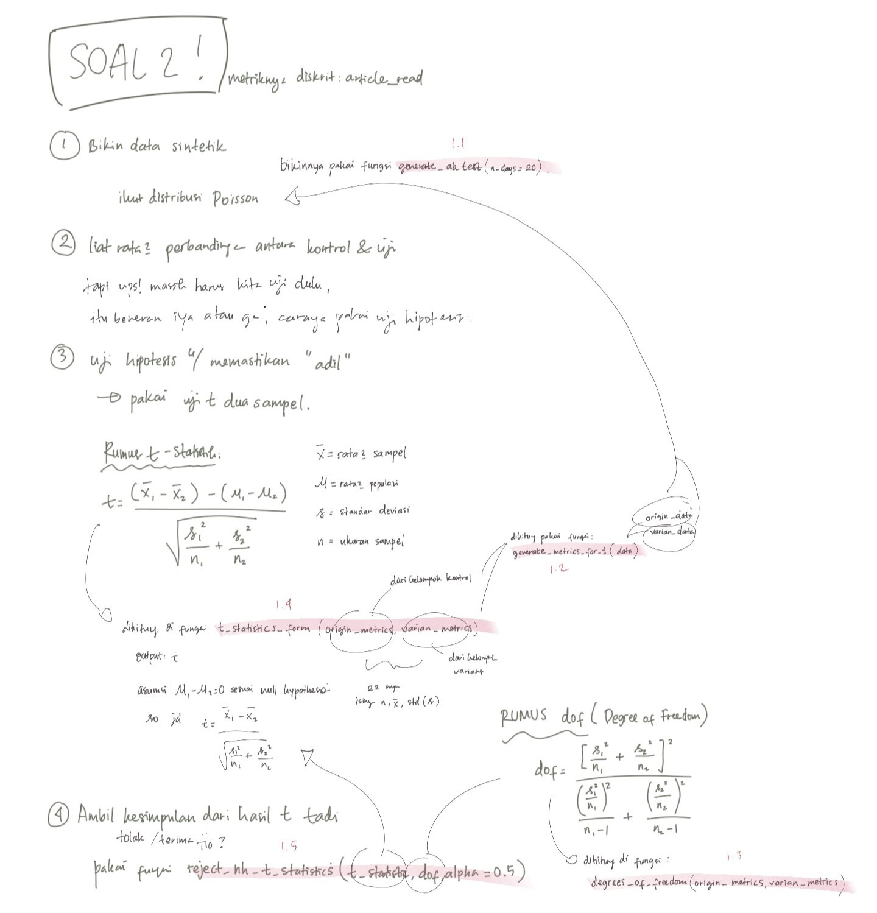
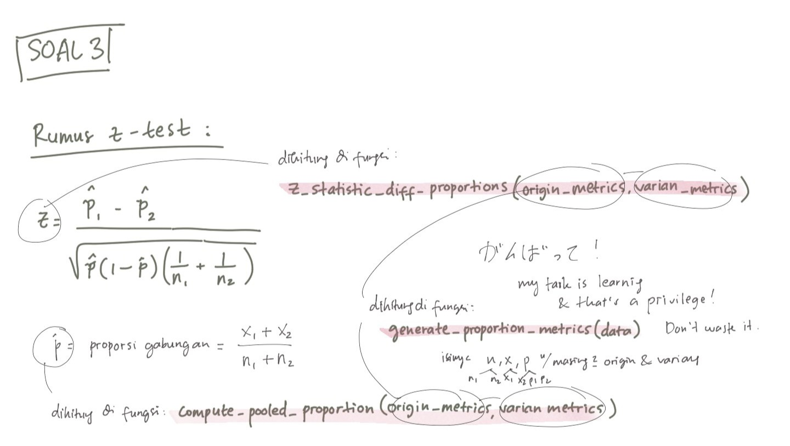

catatan pikiran selama pengerjaan submission [kelas dicoding belajar matematika untuk data science](https://www.dicoding.com/academies/831-belajar-matematika-untuk-data-science).

# soal 1: distribusi dan algoritma naive bayes
## segmen 1: menghasilkan data acak

### tugas 1: membuat data distribusi uniform

#### tugas 1.1: membuat fungsi untuk menghasilkan angka acak uniform
ini fungsi untuk bikin array yang isinya kompilasi angka-angka yang membentuk distribusi uniform. nanti dipakai untuk bangun dataset sintetik, untuk bangun isian kolom fitur beak_head_ratio. 

#### tugas 1.2: membuat visualiasi distribusi uniform
ini biar kebayang, distribusi uniform itu bentuk persebaran datanya seperti apa sih.

### tugas 2: membuat data distribusi gaussian

#### tugas 2.1: distribusi gaussian - inverse cdf
buat bisa bikin kompilasi angka yang membentuk distribusi gaussian, harus bikin dulu perhitungan untuk inverse cdf. ntar ini dipakai di fungsi untuk bikin array berisi angka-angka yang persebarannya ngikutin distribusi gaussian.

#### tugas 2.2: menghasilkan gaussian distribution
fungsi untuk bikin array berisi angka-angka yang persebarannya ngikutin distribusi gaussian.

#### tugas 2.3: membuat visualisasi distribusi gaussian
ini sama kek uniform, biar kebayang visualisasi gaussian itu kayak gimana.

### tugas 3: membuat data binomial distribution

#### tugas 3.1: distribusi binomial - inverse cdf
sda

#### tugas 3.2: menghasilkan binomial distribution
sda

#### tugas 3.3: membuat visualisasi distribusi binomial
biar kebayang visualisasi distribusi binomial.

 

# soal 2: sistem rekomendasi - A/B testing
- Ini ceritanya mau menerapkan suatu fitur baru di blog: sistem rekomendasi.   
    
- Kita pengen tau nih, apakah si fitur baru ini beneran berpengaruh alias bermanfaat untuk user atau ga. Cara taunya ialah dengan mengadakan sebuah tes: **A/B testing**.
- Untuk keperluan A/B testing, kita perlu data dari dua kelompok: kelompok user yang sudah disuguhi sistem rekomendasi, dan satunya lagi kelompok user yang belum disuguhi sistem rekomendasi. Sebut saja **kelompok A, dan B.**
- Karena submission ini sifatnya simulasi, kita perlu bikin data sintesis untuk kedua kelompok A, B. Ga pakai data real.
- Untuk datanya sendiri di-generate mengikuti **distribusi Poisson**. Pakai poisson soalnya angka jumlah artikel yang dibaca bersifat diskrit, dan karena diskrit bisa dimodelkan menggunakan poisson, jadilah di submission ini pakai poisson.
- Dataset sintesis selesai dibuat, lanjut ke pengetesan. 
- Buat ngetes apakah fitur rekomendasi ini berpengaruh atau ga, bisa dong ya kalau kita pakai data rata-rata jumlah artikel yang dibaca user. 
- Dan kalau kita punya angka rata-rata tersebut dari masing-masing kelompok tersebut, kita jadi bisa tahu mempan atau ga fitur barunya. Kek misal kalau angka rata-rata jumlah artikel yang dibaca user kelompok yang sudah disuguhi sistem rekomendai ternyata lebih tinggi dari yang belum disuguhi, berarti yeay fitur sistem rekomendasi nya ngefek.
- Tapi ups! Belum cukup kuat kesimpulannya kalau langsung ditarik berdasarkan observasi awal saja. 
- Supaya makin kuat dan yakin, kita perlu selidiki lebih lanjut untuk memastikan apakah hasil tersebut tidak terjadi secara kebetulan dan apakah dia benar-benar signifikan secara statistik. Caranya dengan?: melakukan **uji hipotesis**.
- Uji hipotesis yang dipakai untuk case ini adalah uji t dua sample (t-test) dengan hipotesis nol sbb:
    - Hipotesis nol (H_0): Tidak ada perbedaan signifikan antara dua kelompok. 
- **t-test** cocok digunakan untuk membandingkan rata-rata. Kata modulnya.
  

# soal 3: software development - A/B testing

